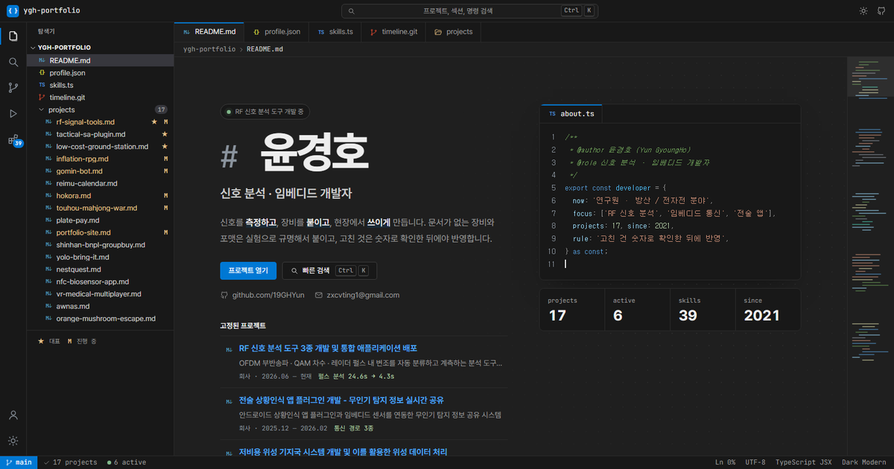

# ygh-portfolio

신호 분석 · 임베디드 개발자 윤경호의 포트폴리오입니다. 코드 에디터(VS Code) 작업 화면처럼 만들었습니다.

**https://19ygh.netlify.app**



## 어떻게 생겼나

| 화면 | 내용 |
| --- | --- |
| `README.md` | 첫 화면. 이름과 소개, 고정된 대표 프로젝트, "이렇게 일합니다"(소개 문장을 근거 프로젝트로 연결) |
| `profile.json` | 경력 · 기본 정보 · 교육 · 논문 |
| `skills.ts` | 직접 써 본 기술 |
| `timeline.git` | 분야를 브랜치처럼 나눠 프로젝트를 시간순으로 놓은 타임라인 |
| `projects/` | 프로젝트 카드 목록 (분야 필터 · 정렬) |
| 프로젝트 상세 | 마크다운 미리 보기 모양. 머리말, 대표 수치, 기능 체크 목록, 문제와 해결을 비교(diff) 화면처럼 나란히 |

작업 화면 틀은 제목 표시줄 · 활동 막대 · 탐색기 · 편집기 탭 · 미니맵 · 상태 표시줄로 되어 있고,
`Ctrl+K`(또는 `/`)로 여는 명령 팔레트에서 프로젝트 이름 · 기술 · 분야로 검색해 바로 이동할 수 있습니다.
`Ctrl+B` 는 탐색기를 접고 폅니다. 다크 / 라이트 테마를 지원합니다.

## 쓴 웹 기술

| 기술 | 어디에 |
| --- | --- |
| View Transitions API | 테마 전환(누른 자리에서 원이 퍼짐), 목록 카드 제목이 상세 제목으로 이어지는 전환 |
| CSS 스크롤 타임라인 (`animation-timeline`) | 진입 효과, 미니맵 슬라이더, 상세의 읽은 막대, 상태 표시줄의 스크롤 % |
| `@property` | 대표 카드 테두리 회전 그라디언트, 스크롤 %를 정수로 세는 CSS 카운터 |
| CSS 앵커 위치 지정 | 타임라인 막대에 붙는 요약 말풍선 (화면 끝에서 자동으로 뒤집힘) |
| 컨테이너 쿼리 | 화면 폭이 아니라 편집기 폭에 맞춘 배치 |
| `light-dark()` · `color-mix()` | 두 테마 색을 한 줄로 |
| `<dialog>` + `@starting-style` | 명령 팔레트 · 증명서 보기 |
| `::details-content` + `interpolate-size` | 탐색기 폴더 접고 펼치기 |

최신 기능은 `@supports` 로 감싸거나 기본 상태를 '보임'으로 두어, 지원하지 않는 브라우저에서는 효과만 빠지고 내용은 그대로 보입니다.

> 빌드(cssnano)가 CSS 선언을 알파벳순으로 정렬하기 때문에 `animation` 단축 속성을 쓰면 `animation-timeline` 이 초기화됩니다.
> 스크롤 타임라인을 쓰는 곳은 `animation-name` · `animation-fill-mode` 같은 개별 속성으로 적어야 합니다.

## 기술 스택

React 19 · TypeScript · React Router 7 · Create React App (react-scripts 5) · CSS · Netlify

## 구조

```
src/
  data/
    projects.ts     프로젝트 내용 (제목 · 기간 · 수치 · 기능 · 문제와 해결 · 결과 · 회고)
    explorer.ts     탐색기 · 탭 · 명령 팔레트에 보이는 파일 이름
    skills.ts       기술 목록
    career.ts       경력
  assets/projects/<id>/   프로젝트 이미지 (폴더에 넣으면 자동으로 모은다)
  components/
    ide/            작업 화면 틀: 제목 표시줄, 활동 막대, 탐색기, 탭, 상태 표시줄, 명령 팔레트, 미니맵
    *Section.tsx    첫 화면의 각 섹션
    ProjectDetail.tsx  프로젝트 상세
  hooks/            테마, 지금 보고 있는 섹션, 스크롤 진입 효과
  utils/            화면 전환, 스크롤 위치 기억, 이미지 수집, 집계
public/_redirects   상세 주소로 바로 들어와도 열리도록 (Netlify SPA)
```

프로젝트 데이터 한 곳(`projects.ts`)에서 카드 · 타임라인 · 상세 · 탐색기 · 검색 목록 · 첫 화면 숫자를 모두 만듭니다.

## 프로젝트 추가하기

1. `src/data/projects.ts` 에 항목을 추가합니다. 대표로 보이고 싶으면 `featured: true`.
2. `src/data/explorer.ts` 의 `PROJECT_FILES` 에 탐색기에 보일 파일 이름을 적습니다 (없으면 `project-<id>.md`).
3. 이미지는 `src/assets/projects/<id>/` 에 넣습니다. 파일 이름이 설명이 되고, 앞의 숫자는 순서입니다.
   예: `01-실제 화면 - 첫 화면.png` → 설명 "실제 화면 - 첫 화면"
   가로로 긴 대표 그림을 상세 위쪽 배너로 띄우려면 `coverBanner: true`.

## 실행

```
npm install
npm start          # http://localhost:3000
npm run build      # build/ 에 배포용 파일
```

`main` 에 머지되면 Netlify 가 자동으로 다시 배포합니다.
